# User Manual

This manual is for **pathologists** (who analyse, review and sign) and **viewers** (who analyse and download
reports but cannot sign). Administrators should also read the Administrator Manual.

> **BioMarkHER2 does not make the HER2 diagnosis.** It measures membrane staining cell by cell, and only at a
> validated site suggests a pre-score with the evidence behind it. **You** confirm every score and decide on ISH.
> At this site the AI pre-score is currently **withheld** (shadow mode) until a local validation study is complete;
> the cell evidence, stain measurements and ISH guidance are shown.

Screenshots come from the release installed exactly as at the SDC, with demonstration accounts and demonstration
images (not part of the package).

## 1. Getting access

### 1.1 What you need

* A VPN connection to the SDC network (ask your administrator).
* A current browser: Chrome, Edge or Firefox. A screen at least 1366 px wide is recommended for slides.
* The portal address, for example `https://10.5.93.57` or the SDC host name, and your account.

Your administrator creates your account and gives you either a **temporary password** or a one-time
**invite link** (valid 72 hours).

### 1.2 Signing in

Open the portal address and enter your work email and password. Tick **Keep me signed in** only on a personal,
locked computer.

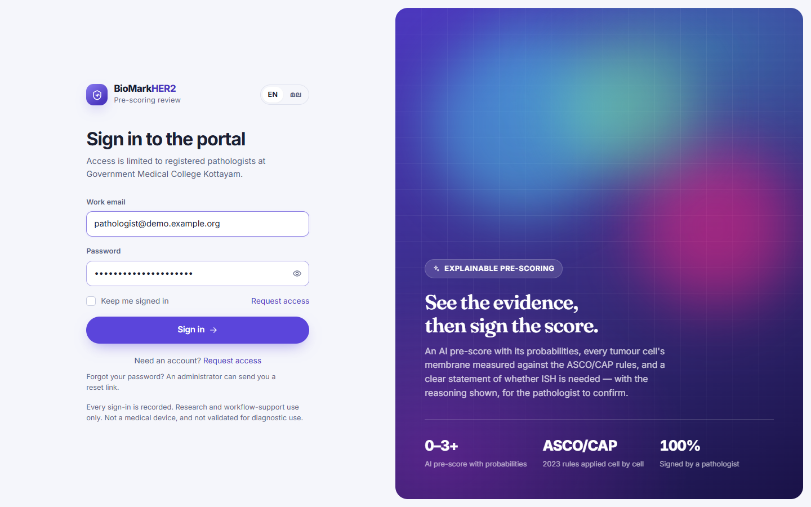

After 5 wrong passwords in a row the account locks for 15 minutes; ask an administrator to unlock it sooner.
Forgotten password: ask an administrator for a reset link. There is no self-service reset, because the system has
no email server.

### 1.3 First sign-in: choose your own password

With a temporary password you must choose a new one before continuing. Use at least 10 characters; a few unrelated
words work well. Changing the password signs you out on every other device.

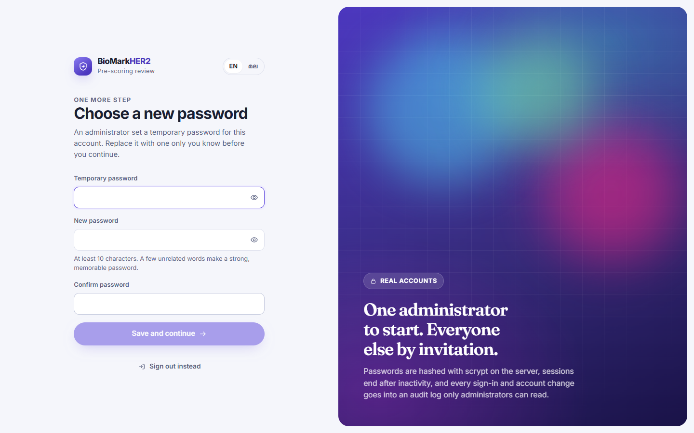

### 1.4 The portal at a glance

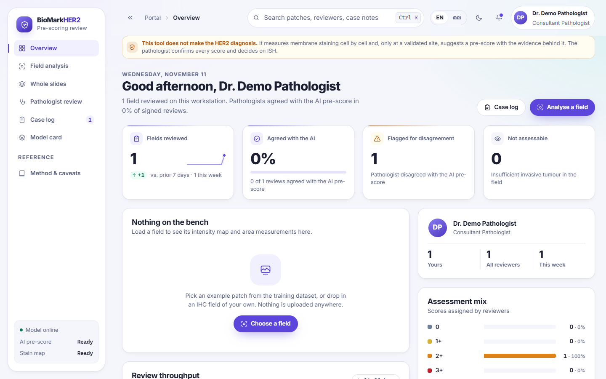

| Area | What it is |
|---|---|
| **Sidebar** | Overview, Field analysis, Whole slides, Pathologist review, Case log, Model card, Method & caveats. Administrators also see Admin console. |
| **Yellow banner** | The standing reminder that the tool does not make the diagnosis. |
| **Top bar** | Search, language (EN / Malayalam), light/dark theme, notifications, your profile and sign-out. |
| **Model status** (bottom left) | Whether the AI pre-score and the stain map are loaded. |

## 2. Analysing a field (one image)

Use **Field analysis** for a single microscope field or a region exported from a slide: PNG, JPEG or TIFF, up to
24 MB, ideally 40× (about 0.25 µm per pixel) and at least 1024 × 1024 px.

1. Open **Field analysis**.
2. Under **Field source**, drop an image or click to choose one. Check **Tumour site**; it is *breast* by default.
   Gastric HER2 rules differ and are refused.
3. Click **Analyse field**. Analysis takes about 20–30 seconds; a progress indicator is shown.

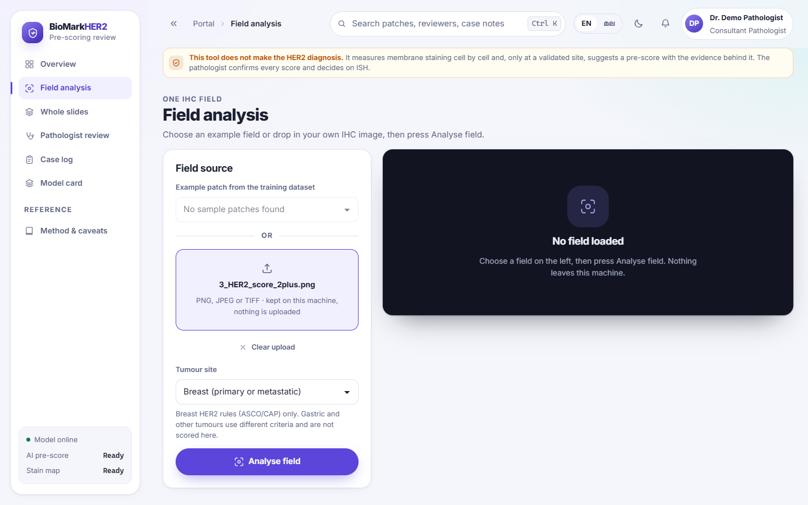

### 2.1 Reading the result

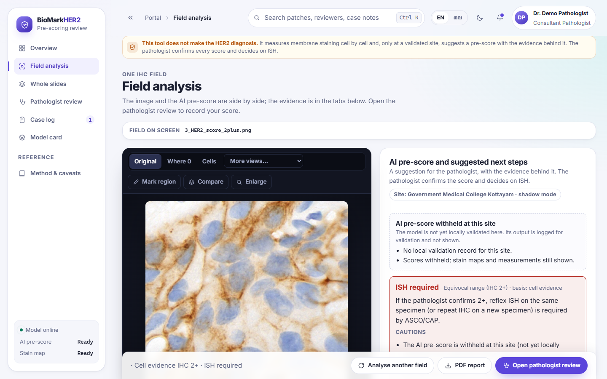

The left panel shows the image; the right panel answers "what does the system suggest, and what next?".

| Element | Meaning |
|---|---|
| **Site badge** | The site name and its gate status. *Shadow mode* means the AI pre-score is withheld here. |
| **AI pre-score** | At a validated site: the suggested grade, the probability of each grade, confidence and a 90% prediction set. At this site: "AI pre-score withheld at this site". |
| **ISH box** | **ISH required**, **ISH / second review recommended**, or **ISH not indicated by IHC**, with the basis (here *cell evidence*) and cautions. |
| **Bottom bar** | Summary of the cell evidence and ISH suggestion, **PDF report**, **Open pathologist review**. |

### 2.2 Image views

The tabs above the image switch views. Each one shows a different kind of evidence:

| View | Shows |
|---|---|
| **Original** | The image as scanned, before any processing. |
| **Where …** | Only one staining-intensity class painted (the one selected), everything else as scanned, so a small class is easy to find. |
| **Cells** | Cell membrane map: every detected cell's membrane in its ASCO/CAP category colour (0 grey, 1+ yellow, 2+ orange, 3+ red). |
| **More views…** | Tissue mask (what the percentages are measured over), intensity map (model), DAB heatmap (unbucketed), threshold baseline (classical), confidence map (where the model's prediction is ambiguous), and, at a validated site, AI evidence (Grad-CAM) and regional pre-scores. |
| **Mark region** | Draw a box around an area and give it a score; saved with your name (pathologists only). |
| **Compare** | Two views side by side. |
| **Enlarge** | Full-screen zoom and pan. |

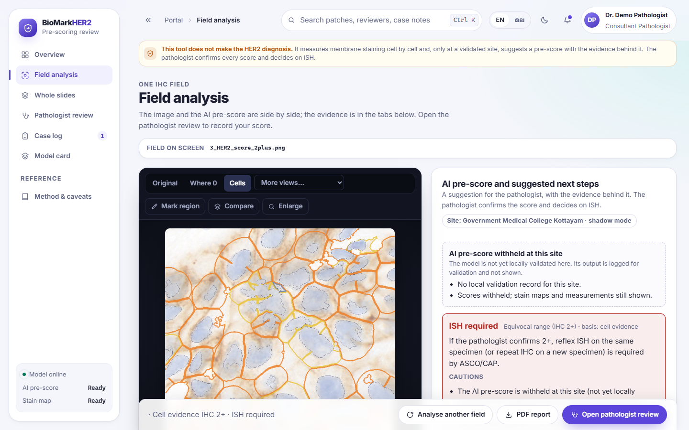

### 2.3 Evidence and details

Below the image, the **Evidence and details** tabs explain the result:

* **ISH decision evidence**: where the case sits in the ASCO/CAP algorithm, evidence for and against ISH, a quality
  checklist ("can this field be trusted?"), how close the cell percentages are to the 10% cut-off, whether a slightly
  different reading would change the grade, and the exact cell counts needed to change it.
* **Why this result**: a step-by-step explanation in words.
* **Stained area**: the percentage of tissue at each staining intensity (model and classical baseline).
* **Marked regions**: regions you or colleagues marked on this field.
* **Limits of this tool**: what the system cannot judge.

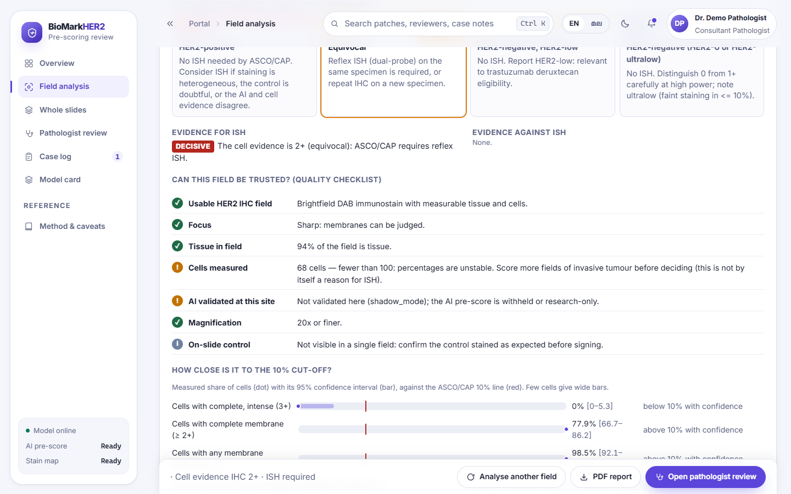

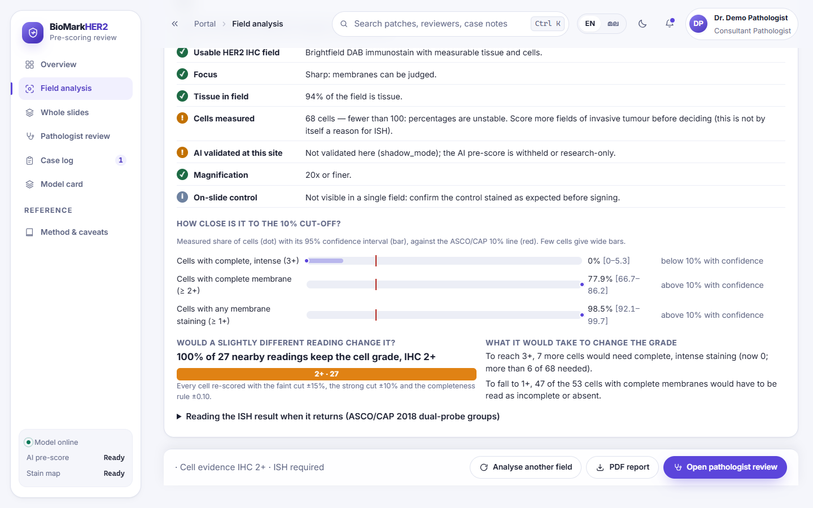

### 2.4 "Not assessable"

If an image cannot be scored, the system says **Not assessable** and gives no AI pre-score, no cell category and no
ISH suggestion. The reasons and what to do are listed. Common causes: out of focus, too few cells (fewer than 30),
not an IHC stain (H&E), a nuclear stain (ER/PR/Ki-67), greyscale image, marker ink, blank glass.

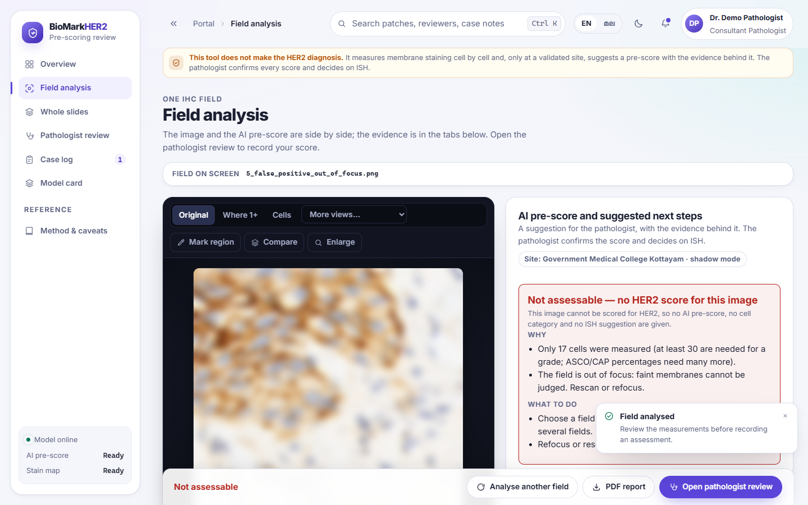

### 2.5 PDF report

**PDF report** downloads a report of what is on screen: the images, cell evidence, ISH decision page, explanation
and caveats, and a sign-off block. It is designed to remain readable when printed in black and white.

## 3. Whole slides

Use **Whole slides** for scanned slides: `.svs`, `.tif/.tiff`, `.ndpi`, `.mrxs`, `.scn`, `.bif`, `.vms`, `.vmu`, up to
8 GB. Slides scanned at 20× or 40× (0.5 µm per pixel or finer) are needed for scoring.

1. Open **Whole slides**. Choose a slide from the list, or **Upload slide** to add one. Large files take several
   minutes over VPN; your administrator can also copy slides directly onto the server.
2. The slide opens in the viewer: scroll to zoom, drag to pan.
3. Optional but recommended: **Mark tumour regions**. Drag boxes around invasive tumour. Scoring is then restricted
   to those regions, as ASCO/CAP intends. Without regions, fields are chosen automatically across all usable tissue.
4. Click **Analyse slide**. A progress bar shows each stage (tissue, ink and film check, control, fields, cells).
   A slide takes about 4–11 minutes. You can leave the page and return.

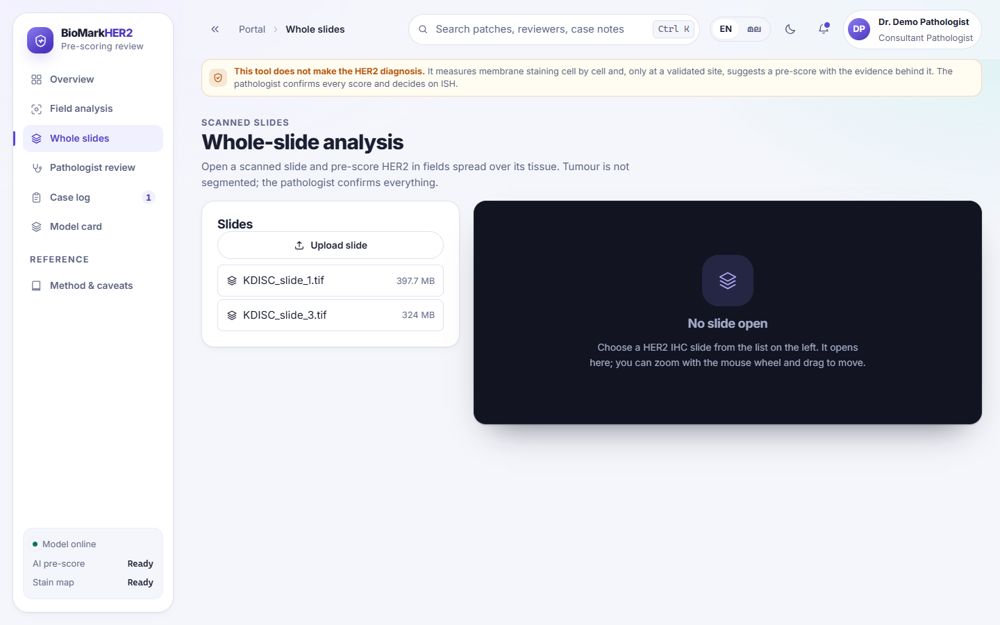

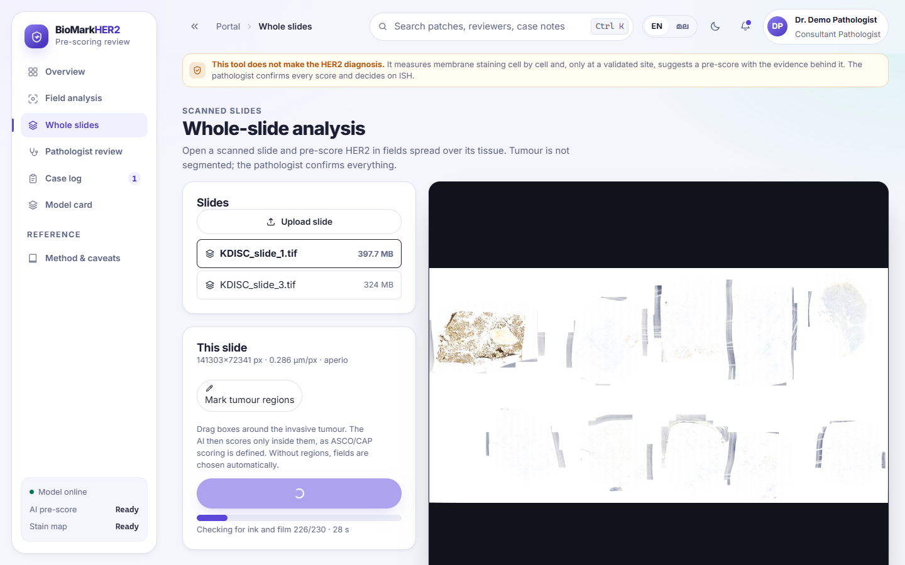

### 3.1 Reading a slide result

* **Overlay** (left panel): *Excluded tissue* (ink, film, control cores), *Grade map* (the grade of each analysed field) or *None*.
* **Hotspot fields** (Evidence and details): the fields that weighed most; click one to zoom to it.
* **Cell evidence** pooled over all measured cells, the **ISH suggestion**, heterogeneity across fields, and any
  **flags** (control core found and excluded, ink, magnification, too few cells, rejected fields).
* **PDF report** for the slide.

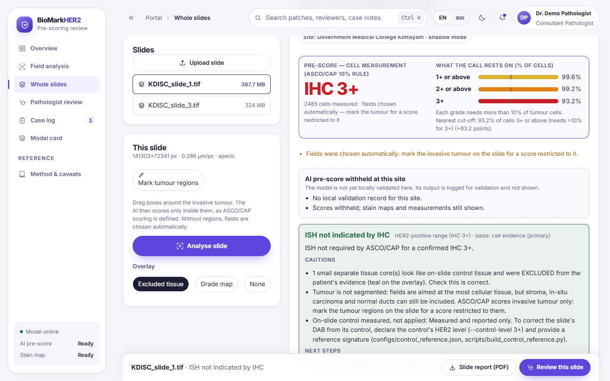

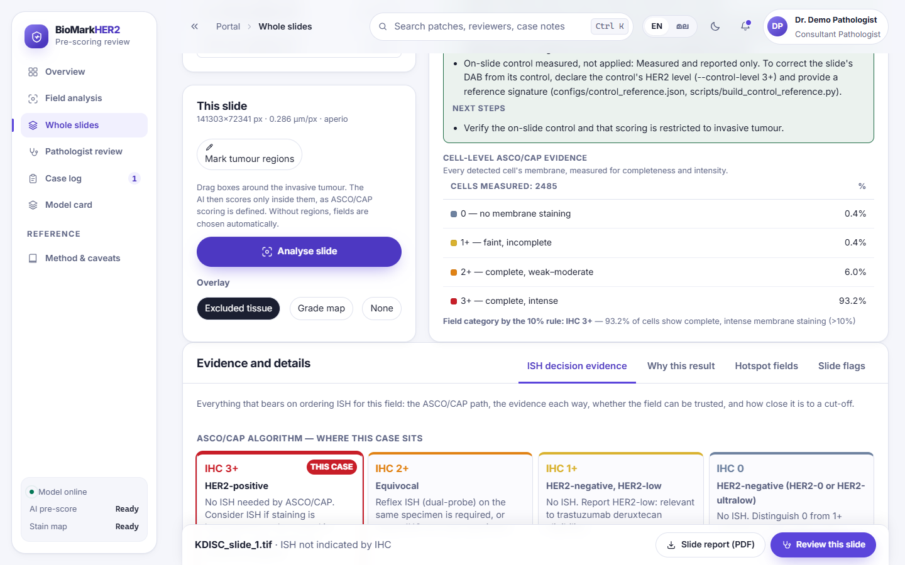

**The system does not find tumour.** Unless you mark regions, fields can include stroma, DCIS or normal ducts. Always
confirm that the scored area is invasive tumour.

## 4. Recording your assessment (Pathologist review)

From a field or slide result, click **Open pathologist review**. The left column shows what the system showed; the
right column is the laboratory record.

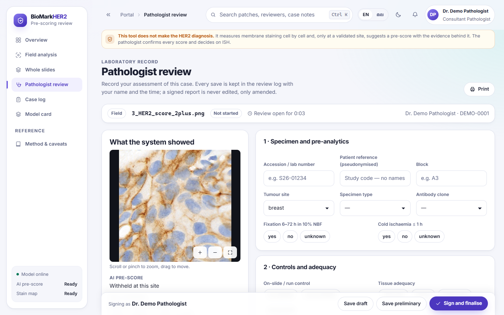

| Section | Fill in |
|---|---|
| 1 · Specimen and pre-analytics | Accession number, **pseudonymised** patient reference (no names), block, specimen type, antibody clone, fixation 6–72 h, cold ischaemia ≤ 1 h |
| 2 · Controls and adequacy | Control acceptable?, tissue adequacy, approximate invasive tumour cells assessed |
| 3 · HER2 IHC assessment | **Your score** (0 / 1+ / 2+ / 3+ / cannot assess), HER2-ultralow, cell percentages, heterogeneity, staining pattern, artefacts |
| 4 · Agreement with the AI | Agree / disagree / partly with the AI pre-score (or *AI not shown*) and with the cell evidence. A reason is required to disagree. |
| 5 · Decision and follow-up | ISH: not required / ordered (reflex) / recommended / already available / deferred; second opinion |
| 6 · Comments | Comment for the report; internal note (not on the report) |

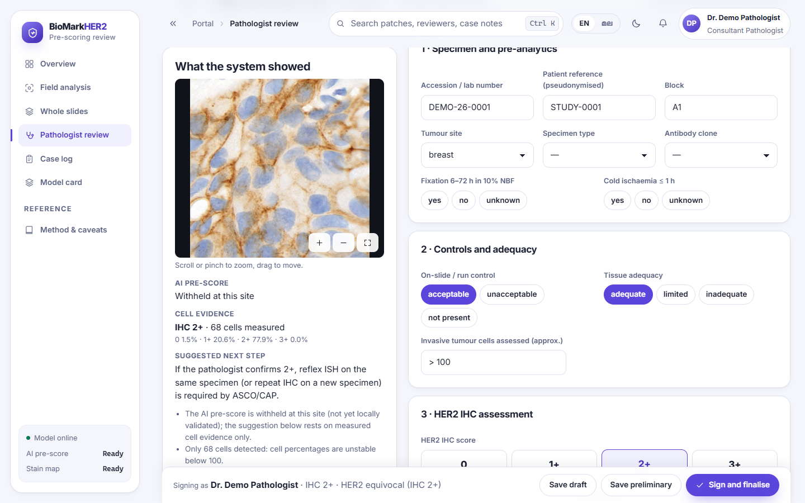

The score is **never pre-filled from the AI**. Choose it yourself.

### 4.1 Saving and signing

* **Save draft**: incomplete, editable.
* **Save preliminary**: complete but not final.
* **Sign and finalise**: tick the attestation ("I have personally reviewed this case…") and confirm.

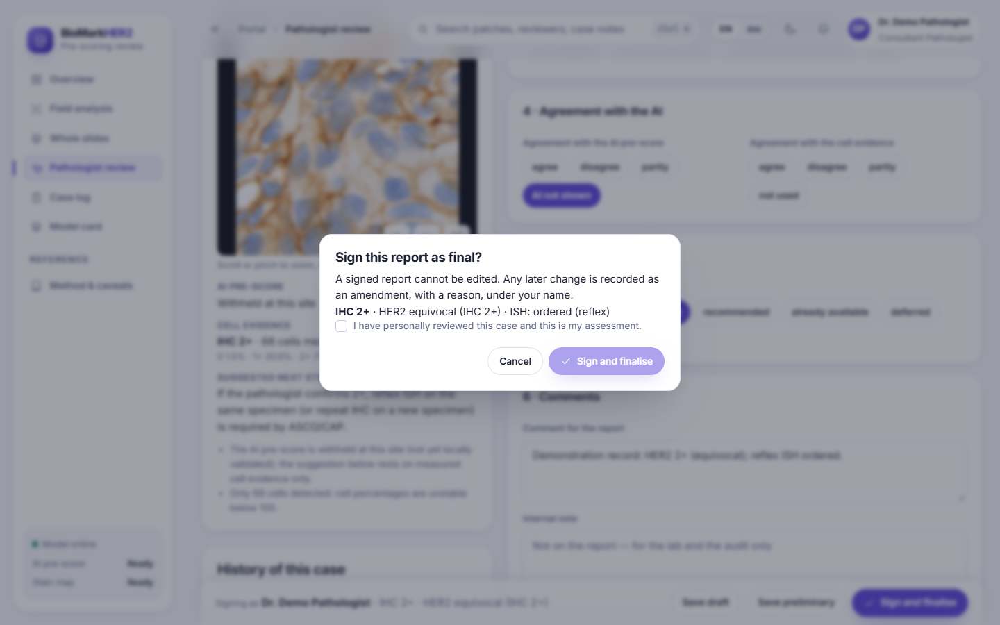

A **final** record is never edited. To correct it, use **Amend**, which requires a reason and creates a new version
that points to the old one. The server refuses a final score when the tissue is marked inadequate, the control is
unacceptable, the tumour site is not breast, or the field has no invasive tumour; it also refuses a negative score on
tissue marked poorly fixed, ischaemic or decalcified.

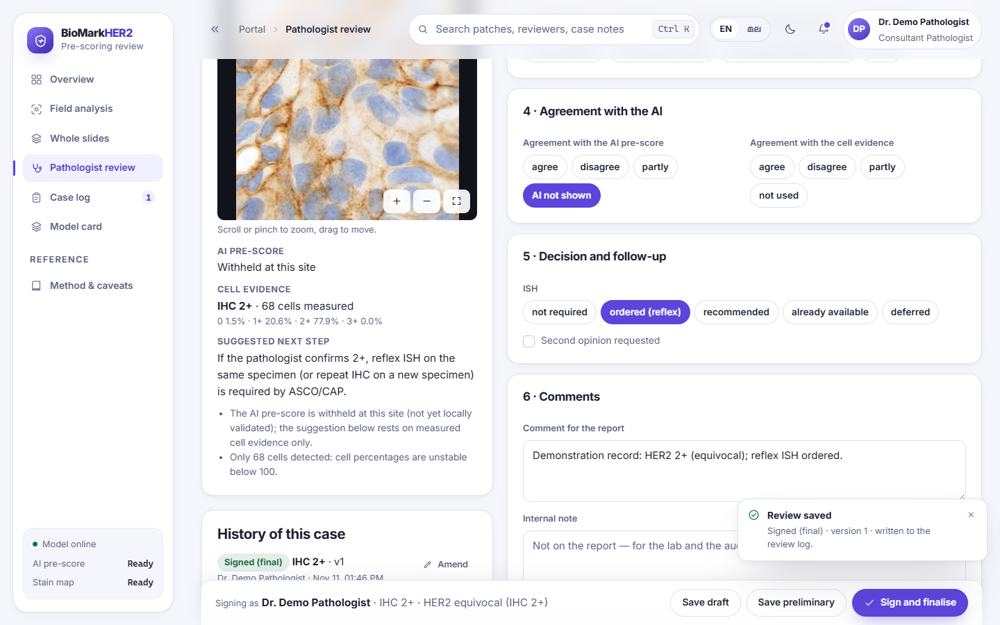

## 5. Case log

**Case log** lists every field and slide you analysed or signed, newest first: AI pre-score (or *Withheld*), cell
evidence (or *Not assessable*), stained tissue, your review status, who analysed it and when. Click a case for its full
history: every analysis, every sign-off and amendment, and marked regions. Pathologists see their own cases;
administrators see everyone's.

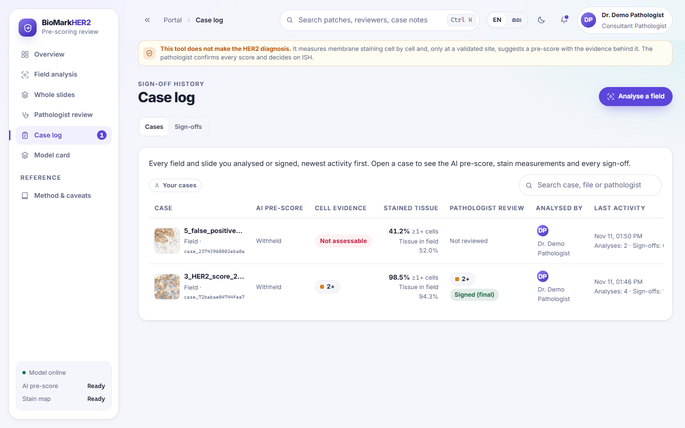

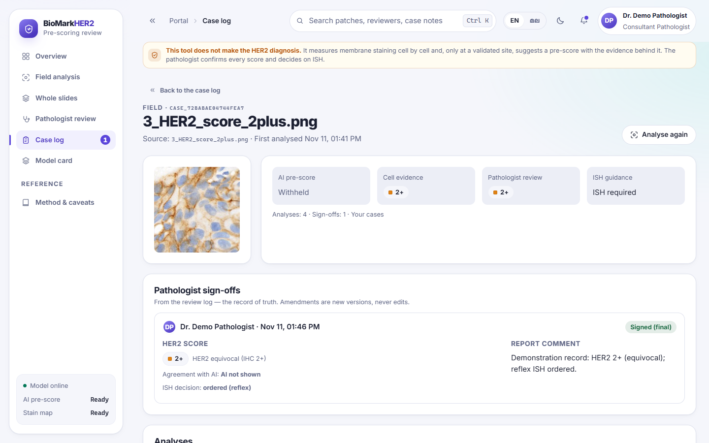

## 6. Model card and Method & caveats

* **Model card**: which models are running, what they were trained on, how well they performed, and where they fail.
* **Method & caveats**: how each number is computed and the limits of the method. Read this once before clinical use.

## 7. Your profile

Click your name (top right) for **Profile**: name, registration number, job title, password, and your signed-in
devices. **Sign out** ends the session on this device; **Sign out other devices** ends the rest.

## 8. Viewers

A viewer can analyse fields and slides and download reports. The review form is locked and explains why. Viewers
cannot sign or mark regions.

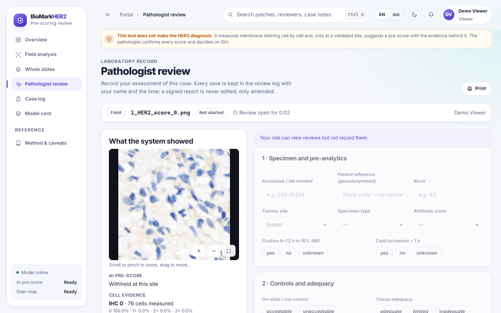

## 9. Interpreting results safely

1. **The score is yours.** Treat every suggestion as a second look, not an answer.
2. **0 vs 1+ (HER2-low)** is the hardest boundary for the system and for pathologists. Re-examine at high power.
3. **Not assessable means not assessable.** Do not try to read a grade from the measurements of a refused field.
4. **Few cells** (fewer than 100) make percentages unstable: analyse more fields.
5. **Tumour is not segmented**: confirm the scored cells are invasive tumour.
6. **Brown pigment** (melanin, haemosiderin) looks like DAB: exclude it yourself.
7. **Pre-analytics** (fixation, ischaemia, decalcification) are not visible in the image: record them.
8. **Shadow mode**: while the pre-score is withheld, your signed reviews are what will validate it. Complete
   section 4 (agreement) honestly. That is how the model is audited.

## 10. Troubleshooting

| Problem | What to do |
|---|---|
| "Your session has ended" | Sign in again. Sessions end after 60 minutes idle or 12 hours. |
| Signed in, then sent back to sign-in | Use the `https://` address. |
| Account locked | Wait 15 minutes or ask an administrator to unlock it. |
| Upload refused | Check the file type and size (fields 24 MB, slides 8 GB). Fields over 64 megapixels are refused: crop them. |
| "Not assessable" | Read the reasons; choose a sharper field with more tumour cells. |
| Slide analysis slow | Expected: 4–11 minutes per slide; only one analysis runs at a time on this server, others queue. |
| Slide upload stops part-way | The VPN may limit large transfers; ask the administrator to copy the slide onto the server. |
| Anything else | Note the time and what you did, and tell the administrator; every action is in the audit log. |
