# Administrator Manual

An **administrator** can do everything a pathologist can, plus run the **Admin console** (sidebar → Admin console,
or `/admin`). This manual covers the console. Server-level tasks (installation, certificates, backups, updates) are in
the Deployment Guide. The full technical reference for accounts and security is `docs/ACCOUNTS_AND_ADMIN.md`
in the source code.

## 1. Roles

| Role | Can | Cannot |
|---|---|---|
| **Administrator** | Everything a pathologist can, plus the Admin console | Change their own role; disable or delete themselves |
| **Pathologist** | Analyse fields and slides, record and sign assessments, mark regions, download reports, see their own case log | Open the Admin console |
| **Viewer** | Analyse fields and slides, download reports | Record an assessment or mark a region |

The server checks the role on every request; hidden buttons are only a convenience. Every assessment is signed with
the signed-in account's name, ID and registration number, taken from the session.

## 2. First administrator

The first administrator is created once, at installation (Deployment Guide §6). Either:

* from the server shell: `docker compose exec app python -m app.admin_cli create-admin --email … --name "…"`, or
* the one-time setup link printed in the server log, which opens this page:

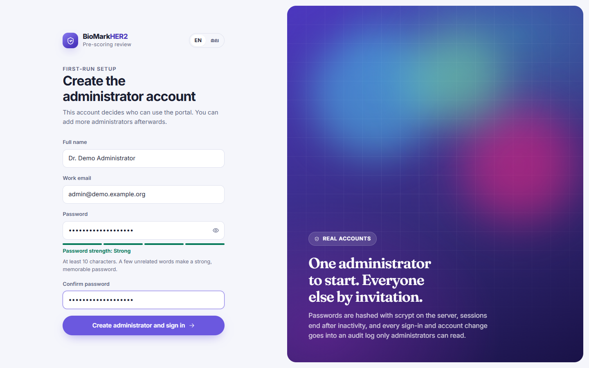

Until an administrator exists, the sign-in page says so:

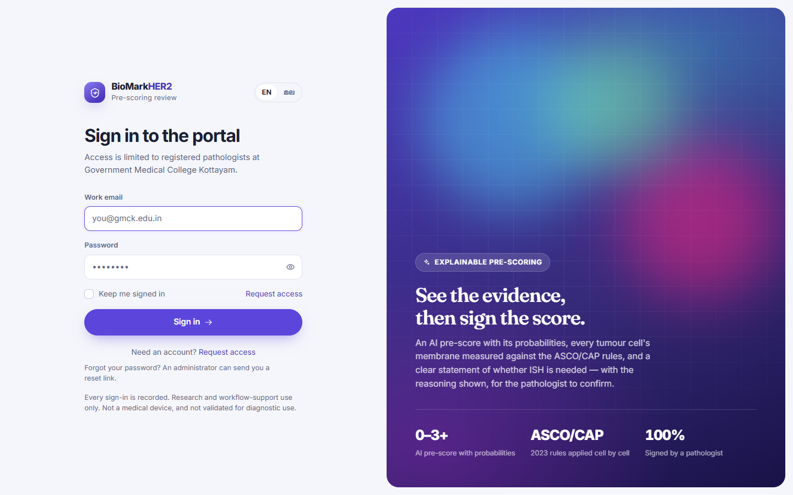

**Create a second administrator straight away.** The console warns while there is only one.

## 3. Users

**Admin console → Users** lists every account with its role, status, last sign-in and date added. Filter by status
(Active, Awaiting approval, Invited, Locked, Disabled) or role, search by name, email, registration number or title,
and **Export CSV**.

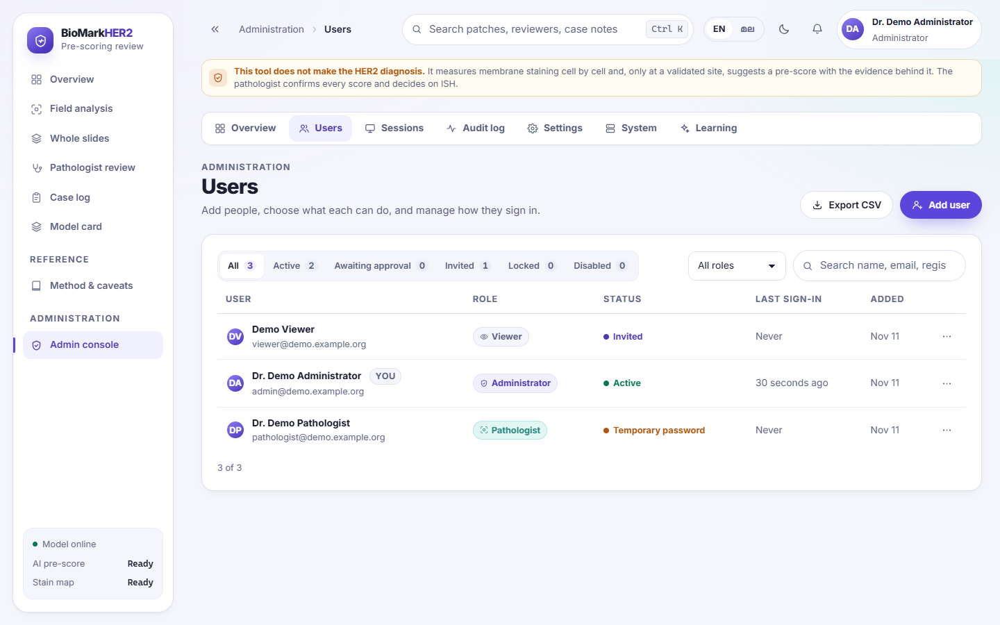

### 3.1 Add a user

1. **Add user**.
2. Full name, email, role, and optionally registration number and job title.
3. Choose how they sign in the first time:
   * **Set a password**: type one or click **Generate**. Leave **Ask them to choose their own password at first
     sign-in** ticked. The next screen shows the portal address, email and password once, with **Copy details**.
     Send the password separately from the email address where possible.
   * **Send an invite link**: they choose their own password; the link works once, for 72 hours. There is no email
     server, so copy the link and send it yourself (for example by the hospital's official messaging).

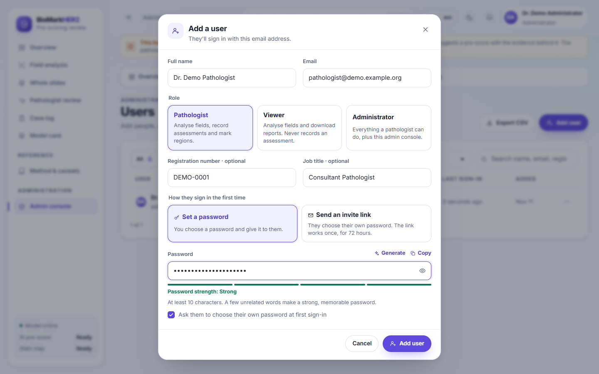

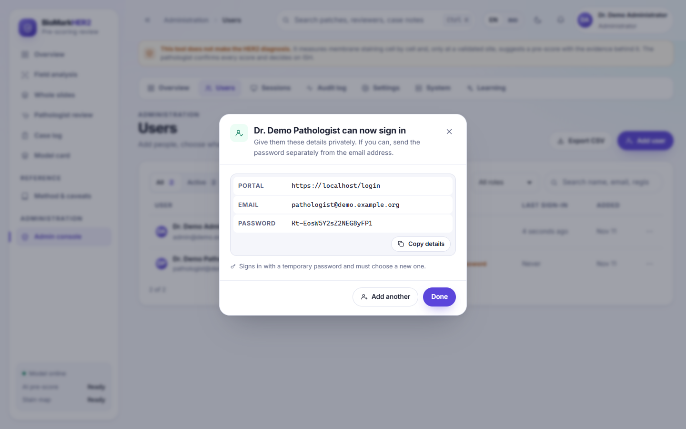

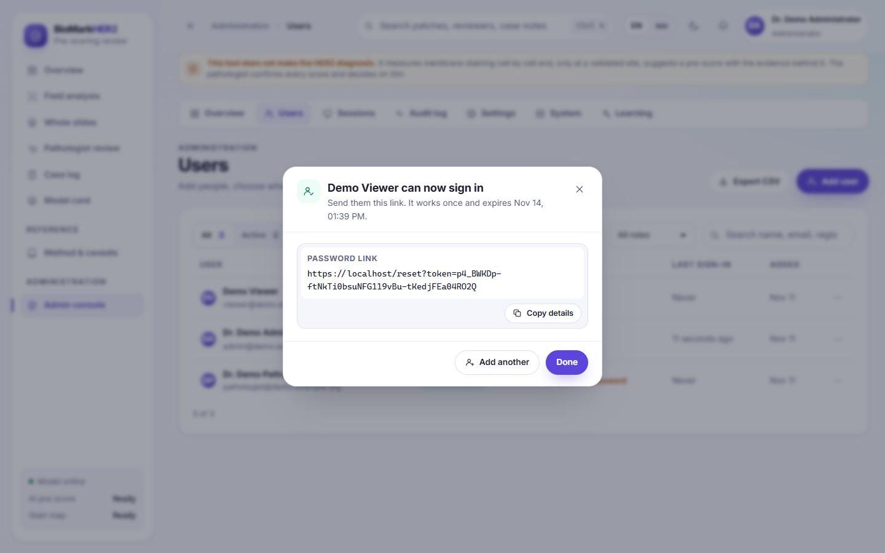

### 3.2 Change, reset, unlock, disable, delete

Click a user to open their panel. From there:

| Action | Effect |
|---|---|
| Edit details / role → **Save changes** | Takes effect on their next request |
| **Set a temporary password** | Their sessions end; they choose a new password at next sign-in |
| **Create a password link** | Single use, 24 hours; a new link cancels the previous one |
| **Unlock** | Clears a lockout (5 failed sign-ins → 15 minutes, by default) |
| **Sign out everywhere** | Ends all their sessions |
| **Disable** | Signs them out everywhere and blocks sign-in; their signed records remain under their name |
| **Delete** | Permanent; you type their email to confirm. Prefer **Disable** for anyone who has signed records. |

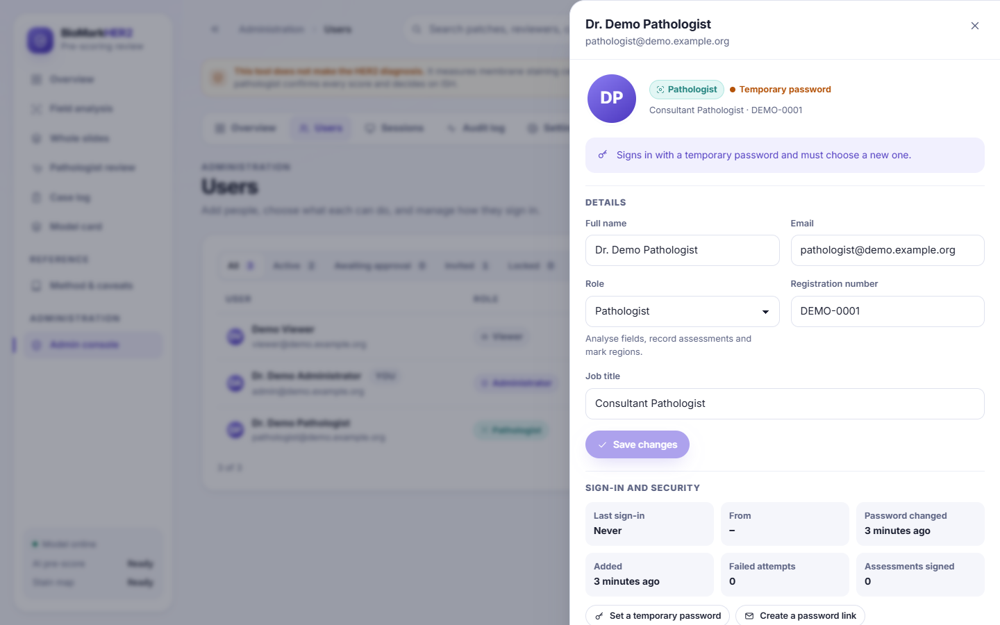

Safeguards: the last active administrator cannot be demoted, disabled or deleted, and nobody can change their own role
or status.

### 3.3 Access requests

With **Settings → Allow access requests** on, people can ask for an account from the sign-in page. Requests appear as
*Awaiting approval* and under **Overview → Needs attention**. **Approve** with a role, or reject. Turn this setting
off if all accounts will be created by administrators (recommended at the SDC).

## 4. Overview

The console's landing page shows counts of users by status, recent sign-ins and failures, items that need attention
(locked accounts, pending requests, readiness warnings) and recent activity.

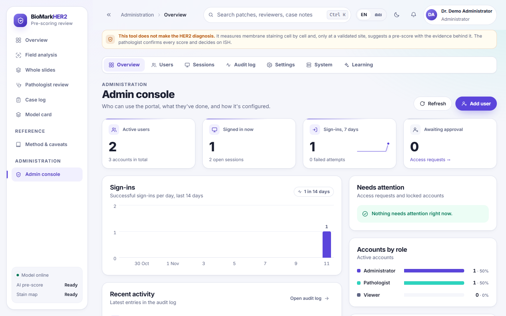

## 5. Sessions

Every signed-in device: user, browser, operating system, IP address, started, last active. **Sign out** ends one
session, for example after a lost laptop.

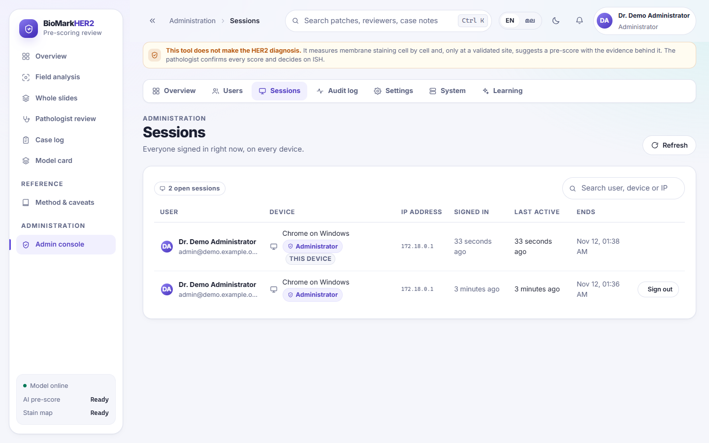

## 6. Audit log

Every sign-in (successful or not), lockout, sign-out, account change, password reset, link created, setting change,
learning action and data export is recorded with who, to whom, from which IP address and when. Filter by category
(sign-ins, accounts, security, settings, exports), time range and free text, and **Export CSV**. The audit log cannot be
edited from the portal.

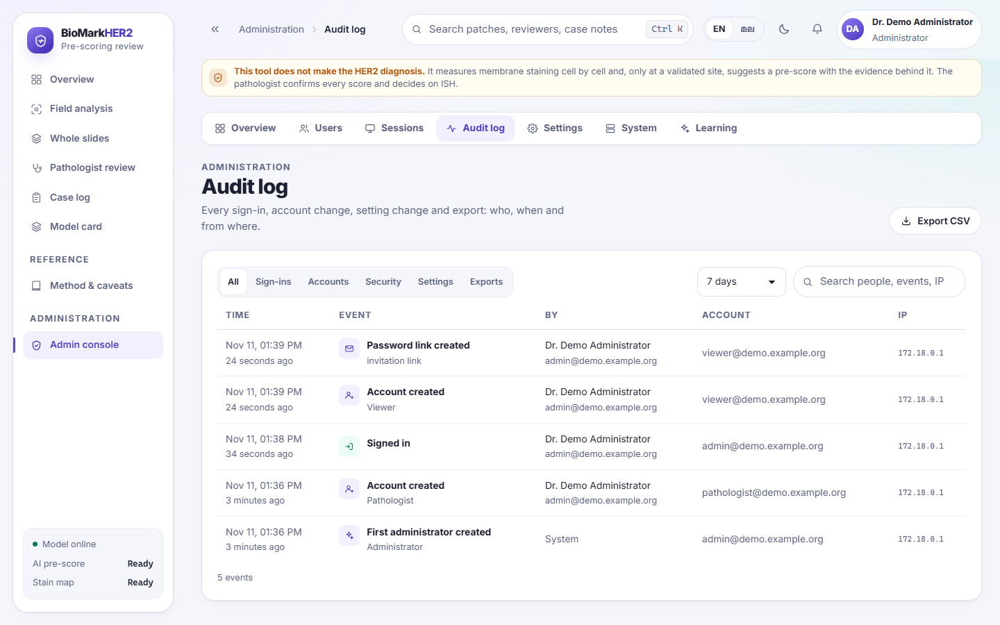

## 7. Settings

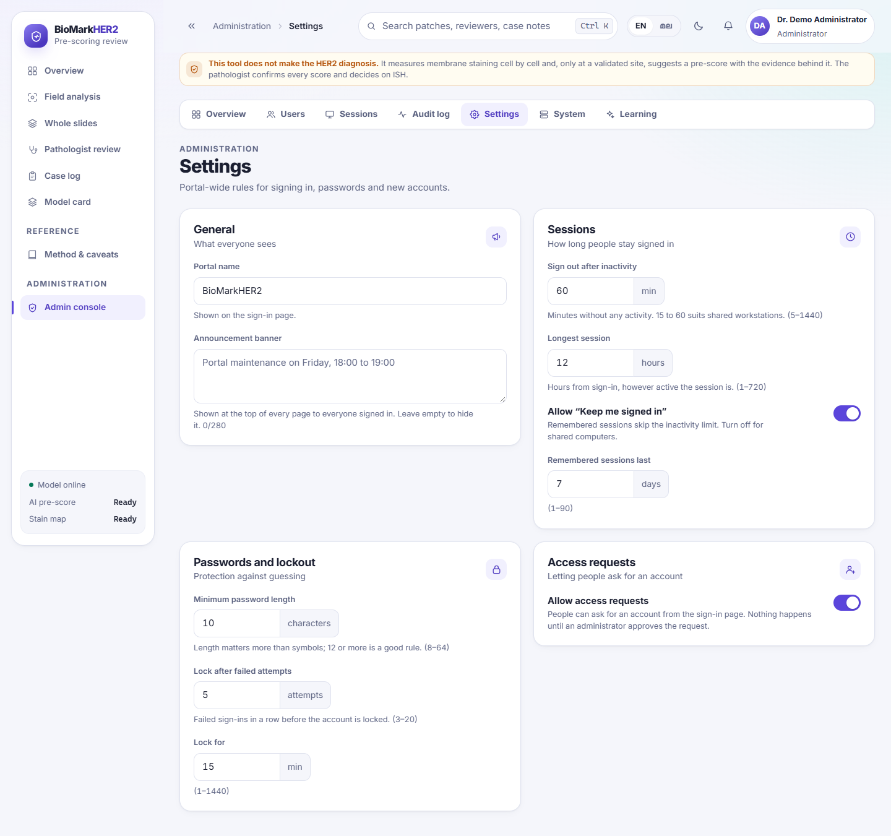

| Setting | Default | Range | SDC recommendation |
|---|---|---|---|
| Portal name | BioMarkHER2 | 1–60 characters | Keep |
| Announcement banner | empty | up to 280 characters | Use for planned maintenance |
| Sign out after inactivity | 60 min | 5–1440 | 30–60 |
| Longest session | 12 h | 1–720 | 12 |
| Allow "Keep me signed in" | on | on/off | **Off** on shared hospital computers |
| Remembered sessions last | 7 days | 1–90 | 7 |
| Minimum password length | 10 | 8–64 | 12 |
| Lock after failed attempts | 5 | 3–20 | 5 |
| Lock for | 15 min | 1–1440 | 15 |
| Allow access requests | on | on/off | **Off** |

Every change is audited with its old and new value.

## 8. System

**System** shows what is running and whether it is ready for other people to use:

* **Deployment readiness**: at least two active administrators; HTTPS with secure cookies; model loaded; uncertainty
  calibration present and current; portal build present. Aim for 5/5 before go-live.
* **Server**: version, address, uptime, secure cookies, proxy mode, Python version, platform.
* **Model**: run, epoch, architecture, calibration status.
* **Data**: where the account database, review log and region annotations live, and their sizes.
* **Exports**: users (CSV), audit log (CSV), review log (JSONL), region annotations (JSONL). Every download is audited.

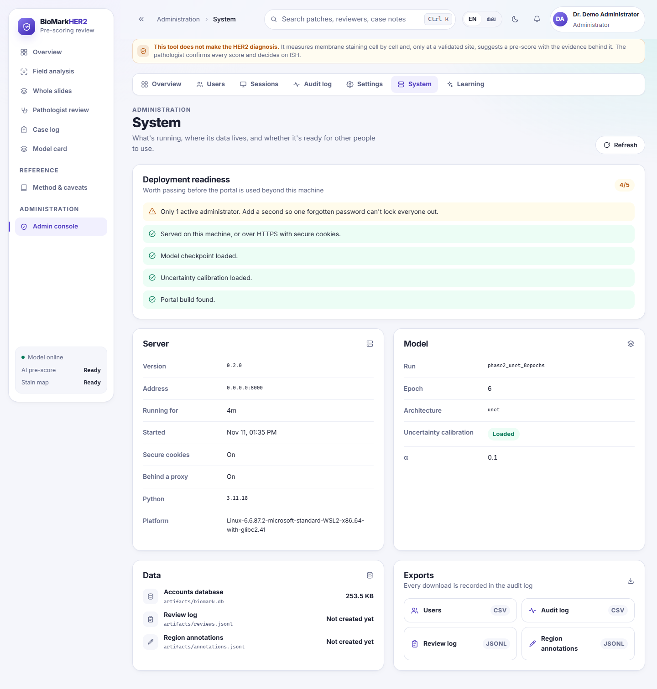

## 9. Learning

**Learning** manages local improvement of the AI pre-score from this hospital's signed cases (Technical
Documentation §8.3).

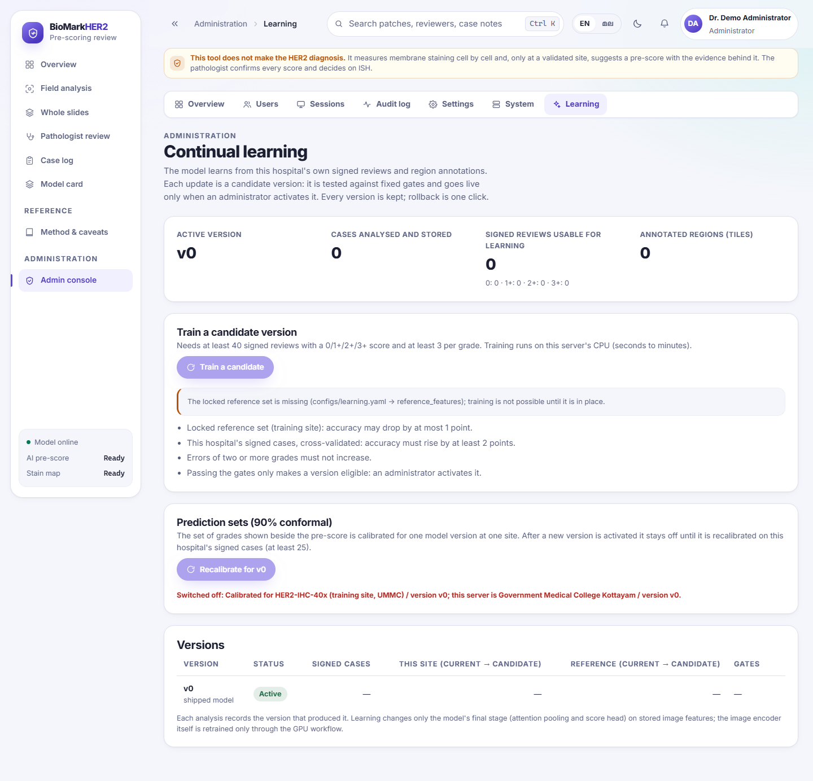

* **Train a candidate version**: available when at least 40 signed final cases exist, with at least 3 per grade.
  Training runs on the server's CPU in seconds to minutes.
* **Gates**: the candidate is judged against fixed rules: no loss on the locked reference set, at least 2 points more
  accurate on local cases (cross-validated), and no new two-grade errors. Only a candidate that passes every gate can be
  activated.
* **Activate / roll back**: activation is manual and audited; new analyses use the version at once and every analysis
  records which version produced it. Any earlier version, including the shipped `v0`, can be re-activated.
* **Prediction sets**: after activating a version, the 90% sets switch off until you **Recalibrate** (needs at least 25
  signed local cases).

> In this release the locked reference file is not included, so **Train** is refused with "Reference features not
> found" until it is supplied. Cases are still collected. Learning does not change the site gate: the pre-score stays
> withheld until the site is validated.

## 10. Data the system keeps

| Data | Where | Retention |
|---|---|---|
| Accounts, sessions, settings, audit log | `artifacts/biomark.db` | Indefinite; export the audit log periodically |
| Pathologist reviews (append-only) | `artifacts/reviews.jsonl` | Indefinite (laboratory record) |
| Case database | `artifacts/cases.sqlite3` | Indefinite |
| Region annotations | `artifacts/annotations.jsonl` | Indefinite |
| Withheld pre-scores | `artifacts/prescore_shadow_log.jsonl` | Until site validation |
| Learning store (images, features, versions) | `artifacts/learning/` | Per hospital policy; images can be disabled (`store_images: false`) |
| Slides | `slides/` | Per SDC retention policy |

Ask users to enter only a **pseudonymised** patient reference. Names and hospital numbers should not be typed into the
system.

## 11. Routine tasks

| When | Task |
|---|---|
| Daily (automatic) | Backup runs at 01:30 (`backup.sh`); check `/var/log/biomark-backup.log` weekly |
| Weekly | Review **Overview → Needs attention**; check locked accounts and failed sign-ins in the audit log |
| Monthly | Disable accounts of people who have left; export the audit log; check disk use (`df -h`) |
| On staff change | Add or disable accounts the same day |
| Quarterly | Test a restore from backup; review Settings; review the shadow log count toward site validation |

## 12. Recovery from the server shell

When nobody can sign in as administrator, use the server shell (`/opt/biomarkher2`):

```bash
sudo docker compose exec app python -m app.admin_cli list-users
sudo docker compose exec app python -m app.admin_cli reset-password --email someone@hospital.org
sudo docker compose exec app python -m app.admin_cli unlock --email someone@hospital.org
sudo docker compose exec app python -m app.admin_cli create-admin --email new-admin@hospital.org --name "Dr. …"
```

Passwords are typed at a hidden prompt, never on the command line.

## 13. Troubleshooting

| Problem | Check | Fix |
|---|---|---|
| A user cannot sign in | Users list: status Locked / Disabled / Invited / Awaiting approval | Unlock, enable, resend link, approve |
| "Your role doesn't allow this" | User's role | Change role (Pathologist to sign) |
| Invite link "expired or used" | Link older than 72 h or already used | Create a new password link |
| Readiness shows "Only 1 active administrator" | Users | Add a second administrator |
| Readiness shows HTTPS warning | Opened over HTTP or proxy settings off | Use `https://`; check `.env` and Deployment Guide §5 |
| Model "not loaded" in sidebar | Server log | Deployment Guide §13 |
| Pre-score "withheld at this site" | Expected (shadow mode) | Deployment Guide §10 |
| Exports missing records | Review log "Not created yet" | No reviews signed yet |
